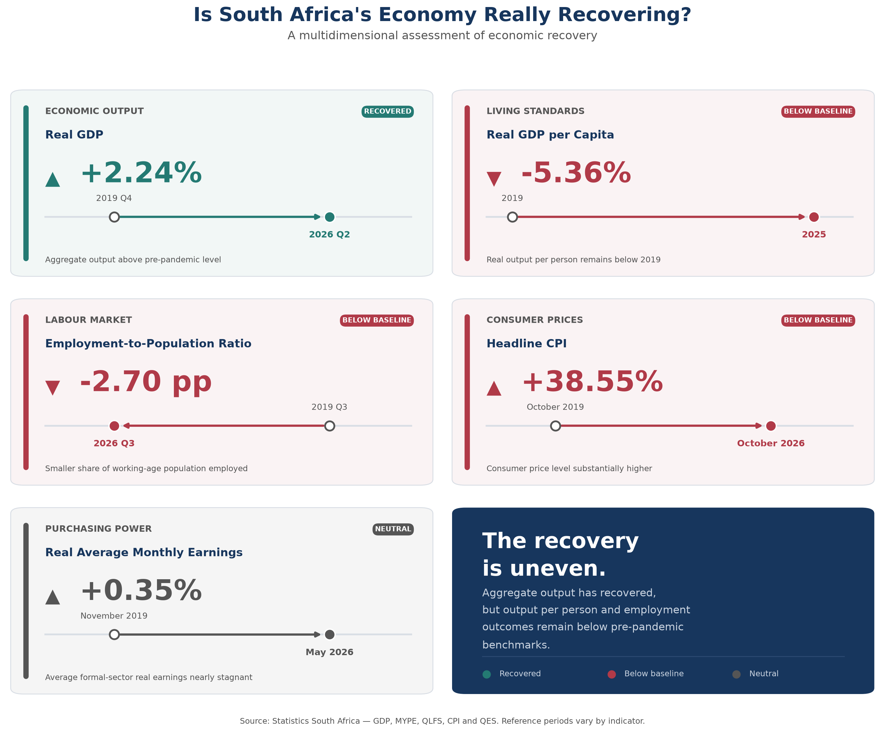
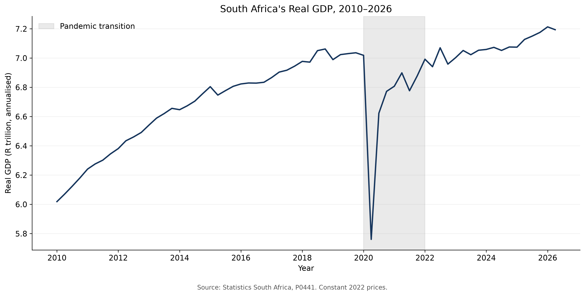
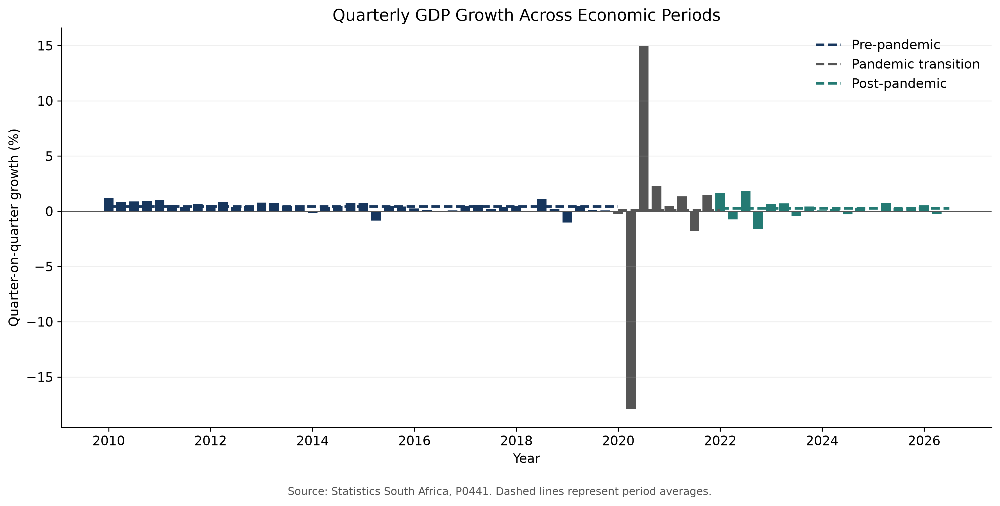
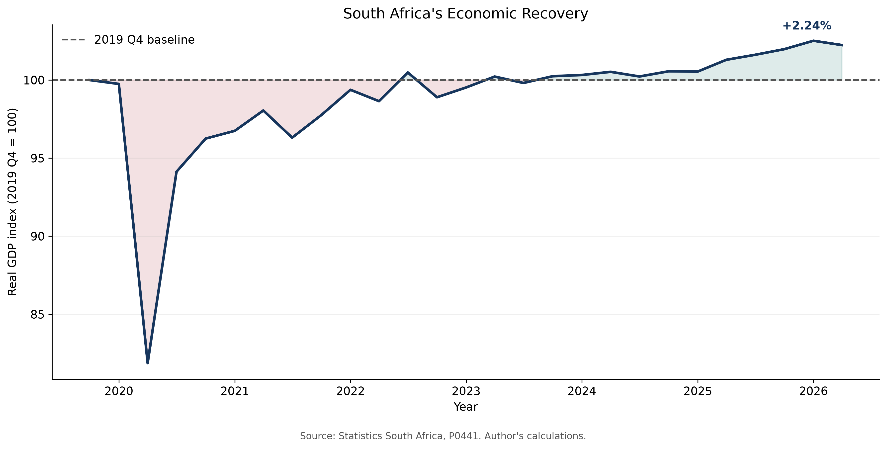
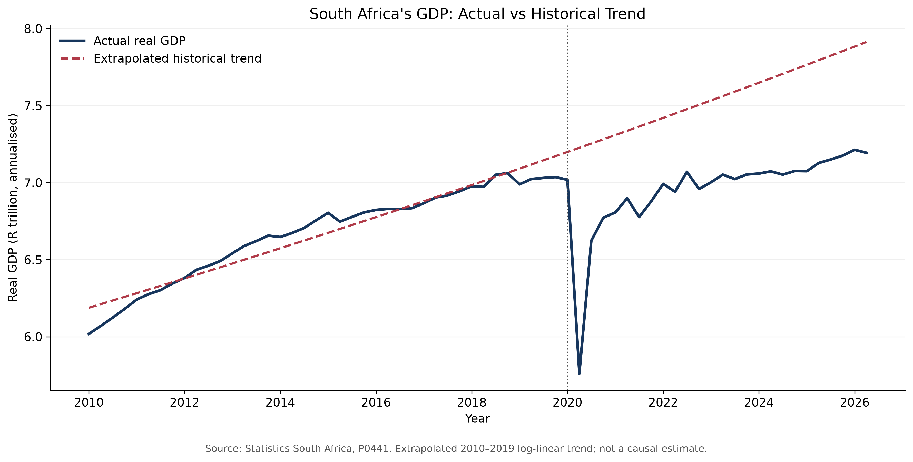
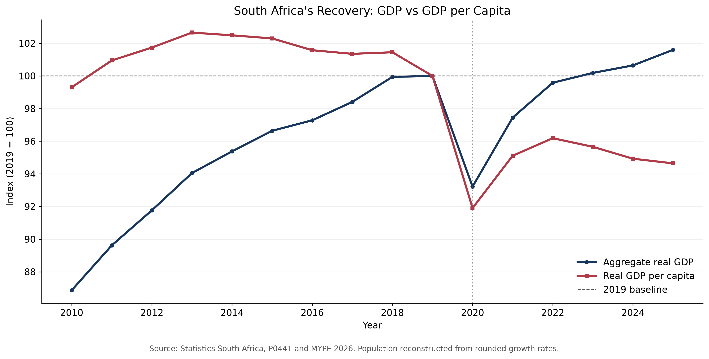
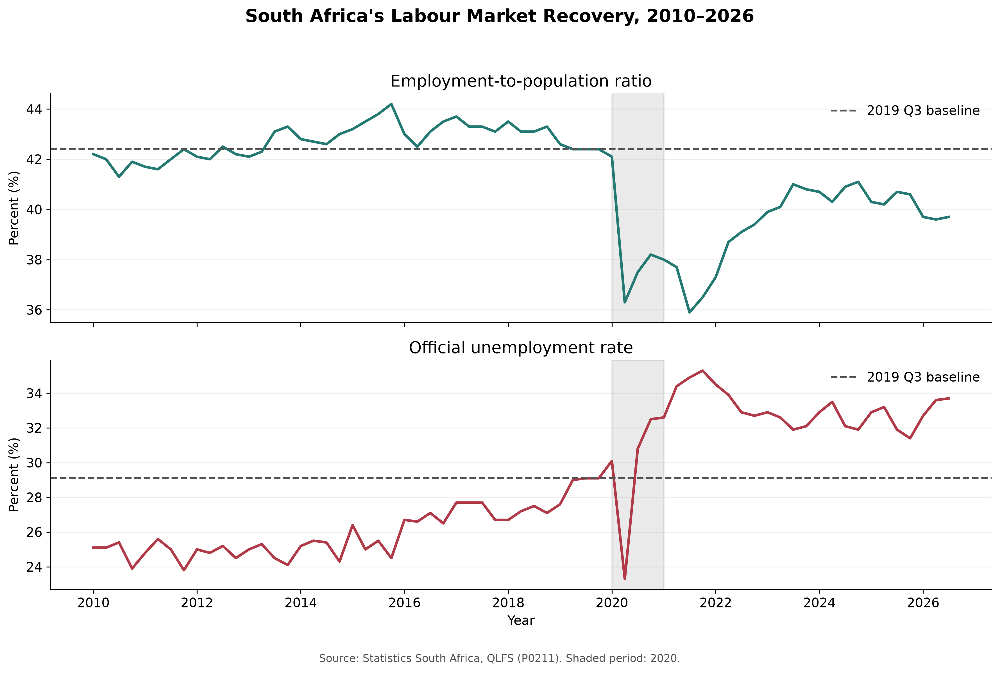
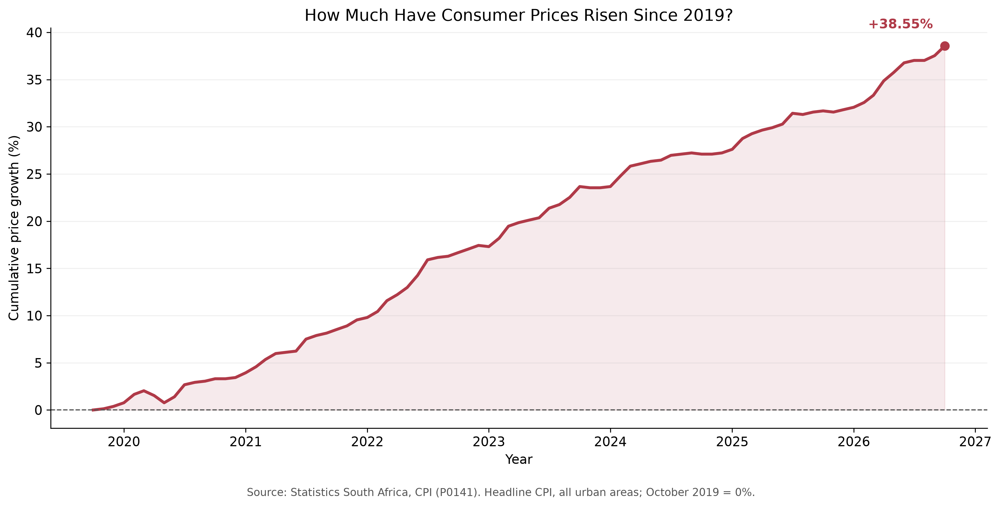
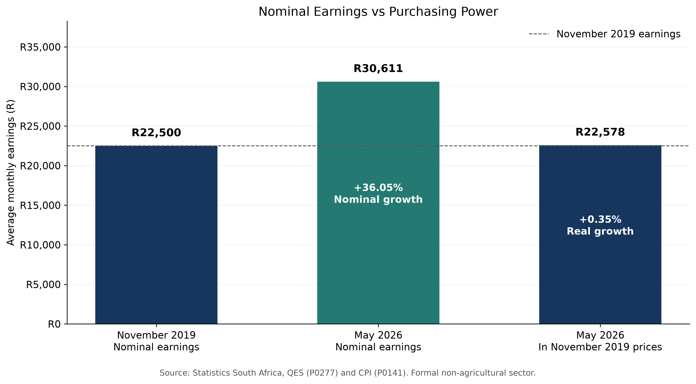

# South Africa's Economic Recovery: A Data-Driven Investigation


## Project Overview

Has South Africa's economy truly recovered from the COVID-19 economic shock, or does aggregate GDP growth conceal weaker economic outcomes?

This independent data analytics project investigates South Africa's economic recovery using official Statistics South Africa datasets covering 2010–2026.

Rather than relying exclusively on GDP, the investigation evaluates five interconnected dimensions of economic performance:

- Aggregate economic output
- Real GDP per capita
- Employment and unemployment
- Consumer price changes
- Real earnings and purchasing power

The project combines economic analysis, statistical inference, data processing and visual storytelling to assess whether aggregate economic recovery has translated into broader economic improvements.

## Economic Recovery Scorecard



## Key Findings

| Indicator | Reference period | Change |
|---|---|---:|
| Real GDP | 2019 Q4 – 2026 Q2 | +2.24% |
| Real GDP per capita | 2019–2025 | −5.36% |
| Employment-to-population ratio | 2019 Q3 – 2026 Q3 | −2.70 pp |
| Consumer price level | Oct 2019 – Oct 2026 | +38.55% |
| Real average monthly earnings | Nov 2019 – May 2026 | +0.35% |

### Central Finding

South Africa has recovered in terms of aggregate economic output, but its recovery remains uneven across several important dimensions of economic well-being.

Additional findings include:

- Average quarterly GDP growth declined from 0.421% to 0.252% across the selected comparison periods, although the difference was not statistically significant (HAC-robust p-value = 0.210).
- Real GDP remains approximately 4.34%–9.09% below selected historical trend extrapolations.
- Employment is approximately 1.17 million below the descriptive benchmark implied by maintaining the 2019 Q3 employment-to-population ratio.
- A representative consumer basket costing R1,000 in October 2019 would cost approximately R1,385.50 in October 2026.
- Average formal non-agricultural real earnings increased by only approximately 0.35% between November 2019 and May 2026.

## Research Objectives

1. Evaluate aggregate real GDP recovery relative to pre-pandemic levels.
2. Compare pre-pandemic and post-pandemic economic growth rates.
3. Assess whether economic growth has kept pace with population growth.
4. Investigate labour-market recovery and employment absorption.
5. Quantify cumulative consumer price increases.
6. Evaluate changes in inflation-adjusted average earnings.
7. Develop a multidimensional economic recovery scorecard.

## Technical Stack

| Tool | Application |
|---|---|
| Python | Data processing and analytical programming |
| pandas | Data cleaning, transformation and aggregation |
| NumPy | Numerical computations |
| Matplotlib | Data visualisation and economic storytelling |
| statsmodels | Regression analysis and statistical inference |
| Jupyter Notebook | Interactive and reproducible analysis |
| Excel | Official statistical source datasets |
| Git and GitHub | Version control and research documentation |
| VS Code | Development environment |

## Analytical Methodology

The project follows an end-to-end analytical workflow:

**Data Acquisition → Data Cleaning → Data Validation → Feature Engineering → Statistical Analysis → Visualisation → Interpretation**

Analytical techniques include:

- Time-series data processing
- Year-on-year and quarter-on-quarter growth calculations
- Index normalisation and rebasing
- Population-adjusted economic analysis
- Historical trend extrapolation
- Ordinary least squares regression
- Heteroskedasticity and autocorrelation consistent (HAC) inference
- Employment benchmark estimation
- Inflation adjustment of nominal earnings
- Multidimensional indicator assessment

Historical trend extrapolations and employment benchmarks are descriptive comparisons rather than causal estimates.

## Research Visualisations

### 1. Aggregate Economic Performance



### 2. Pre-Pandemic vs Post-Pandemic Growth



### 3. Economic Recovery Index



### 4. Historical GDP Growth Trajectories



### 5. GDP vs GDP per Capita



### 6. Labour-Market Recovery



### 7. Cumulative Consumer Price Growth



### 8. Nominal vs Real Earnings



## Data Sources

All economic datasets originate from [Statistics South Africa](https://www.statssa.gov.za/).

| Dataset | Publication |
|---|---|
| Quarterly Gross Domestic Product | P0441 |
| Mid-Year Population Estimates | P0302 |
| Quarterly Labour Force Survey | P0211 |
| Consumer Price Index | P0141 |
| Quarterly Employment Statistics | P0277 |

The investigation uses the available historical and 2026 reference-period observations for each indicator.

## Repository Structure

```text
sa-economic-recovery/
│
├── data/
│   ├── raw/
│   └── processed/
│
├── notebooks/
│   └── 01_data_acquisition.ipynb
│
├── figures/
│   ├── 01_sa_real_gdp_2010_2026.png
│   ├── 02_gdp_growth_comparison.png
│   ├── 03_gdp_recovery_index.png
│   ├── 04_actual_vs_counterfactual_gdp.png
│   ├── 05_gdp_vs_gdp_per_capita.png
│   ├── 06_sa_labour_market_recovery.png
│   ├── 07_cumulative_consumer_price_increase.png
│   ├── 08_nominal_vs_real_earnings.png
│   └── 09_sa_economic_recovery_scorecard.png
│
├── reports/
│   ├── methodology.md
│   ├── key_findings.md
│   └── medium_article.md
│
├── scripts/
├── requirements.txt
├── .gitignore
└── README.md
```

## Reproducing the Analysis

Clone the repository:

```bash
git clone https://github.com/ShadrackHero/sa-economic-recovery.git
cd sa-economic-recovery
```

Create a virtual environment:

```bash
python -m venv .venv
```

Activate the environment on Windows CMD:

```bash
.venv\Scripts\activate
```

Install the required dependencies:

```bash
pip install -r requirements.txt
```

Launch Jupyter Notebook:

```bash
jupyter notebook
```

Ensure the required source datasets are available in `data/raw/`, then open and execute:

```text
notebooks/01_data_acquisition.ipynb
```

## Research Documentation

- [Research Methodology](reports/methodology.md)
- [Key Research Findings](reports/key_findings.md)
- [Medium Article Draft](reports/medium_article.md)
- [Economic Recovery Scorecard Dataset](data/processed/sa_economic_recovery_scorecard.csv)

## Limitations

- Economic indicators use different reference periods.
- GDP per capita is not a direct measure of household income or income distribution.
- Reconstructed population estimates introduce approximation uncertainty.
- CPI represents average consumer price changes rather than household-specific inflation.
- Average earnings cover the formal non-agricultural sector and may reflect workforce composition, bonuses and seasonal differences between reference months.
- Employment benchmarks and historical GDP extrapolations do not establish causal effects.
- The five indicators are not combined into a single numerical recovery score.

## Conclusion

South Africa's economic recovery is real in terms of aggregate output, but uneven when evaluated through population-adjusted economic performance, employment access and purchasing power.

This investigation demonstrates why economic recovery should be evaluated using multiple indicators rather than aggregate GDP alone.

## Skills Demonstrated

- Exploratory Data Analysis (EDA)
- Data Cleaning and Transformation
- Time-Series Analysis
- Statistical Inference
- Regression Analysis
- Economic Data Analytics
- Data Visualisation
- Analytical Problem-Solving
- Research Documentation
- Data Storytelling
- Reproducible Research

## Author

**Shadreck Themba Ngomane**

Applied Mathematics | Data Analytics | Data Engineering | Statistical Modelling

- [GitHub](https://github.com/ShadrackHero)
- [LinkedIn](https://www.linkedin.com/in/shadreck-ngomane/)
- [Portfolio](https://shadrackhero.github.io/)

---

*An independent economic data analytics project using official South African statistical data.*